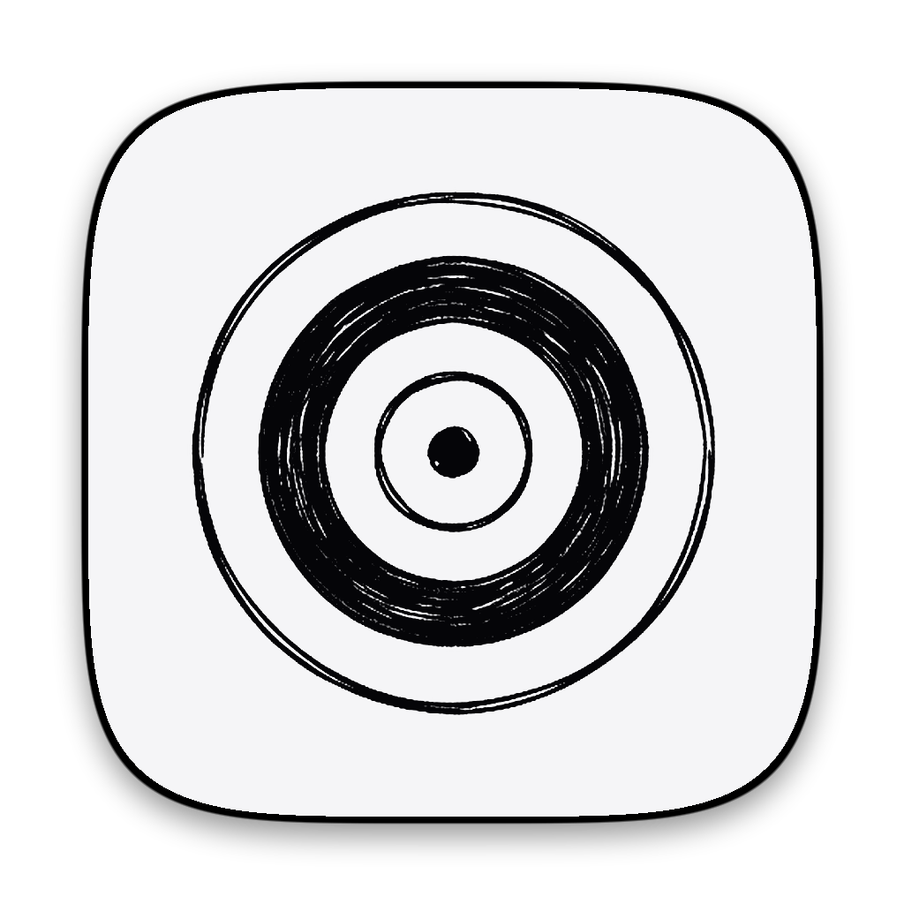

<div align="center">



# Foqz

**Spatial focus canvas, mission control, and local AI copilot for deep work.**

[](LICENSE)
[](#installation--downloads)
[](https://reactflow.dev)
[-purple.svg)](https://ollama.com)

[Download Releases](#installation--downloads) • [Features](#key-features) • [Roadmap](#roadmap) • [Quickstart](#development-setup) • [Architecture](#architecture--project-structure)

</div>

---

## What is Foqz?

Most productivity tools force your thoughts into rigid linear lists or endless database rows. Whiteboards give you spatial freedom, but lack task tracking, timers, and execution workflows.

**Foqz** bridges this gap: a lightweight Electron desktop app that opens an infinite spatial canvas tailored specifically for deep work, task execution, and local-first AI planning. It lives quietly in your menu bar or system tray — summon it instantly with `Cmd+Shift+F`, structure your work on the canvas, lock into a focus session, and hide it when you're in the zone.

---

## Key Features

Content is text, drawing primitives are shapes, and everything else (to-do, focus, GitHub sync, annotations) is a behavior you switch on where you are standing. Nothing moves a node somewhere else to give it meaning.

### ✍️ One kind of text
- Click anywhere with the **Text** tool (`T`) and write. Markdown, checklists and links render in place.
- Pick a style from the node toolbar: **Plain**, **Sticky** or **Card**. Switching keeps the content, position, connections and annotations.
- Make any text a **to-do** with `⌘↵` (or the To-do button): it gets a checkbox, can be focused on, and moves to the Logbook after the workday once done. Cards are always to-dos.

### 🎯 Focus in place
- Press `F` on any text. The camera zooms to it, the rest of the board dims, and a small timer floats on top: pause, +5 minutes, done, leave.
- The timer length comes from Settings. When time is up you get a notification (and an optional chime).
- `Esc` leaves focus.

### 🗺️ Spatial canvas
- Infinite, zoomable canvas powered by **React Flow** (`@xyflow/react`).
- **Regions** group things by area. Drop something inside to adopt it, drag it out to release it, no confirmation. Deleting a region keeps what was inside it.
- Connections are **depends on** or **relates to**. "Depends on" drives the waiting/ready badges and the AI context.
- Sketch-style rectangles, circles and arrows (**Rough.js**), freehand pencil (**perfect-freehand**), pasted images and link cards.
- **Reminders** on any element (bell in its toolbar): a desktop notification when it comes due, even with the window hidden in the tray. Clicking it brings you back to the element.
- **Highlights** in text: `==text==` or `=={blue}text==` (yellow, green, blue, pink, purple, orange) from the text toolbar.

### 💬 Annotations
- Pin a **comment**, **question** or **decision** to any element or to empty canvas, with threaded replies.
- Annotations marked "visible to AI" are included in what the assistant reads about the board.

### 🤖 AI assistant & agents
- **Inline chat** next to any element, a region, or the whole board, with `/` commands (`/todo`, `/expand`, `/criteria`, `/focus`, `/done`, `/rename`).
- Eight native tools, shared with external agents: `get_canvas_summary`, `spawn_text`, `update_node`, `delete_node`, `expand_task`, `start_focus_session`, `stop_focus_session`, `create_github_issue`.
- Three providers: **Ollama** (local, private), any **OpenAI-compatible** endpoint (OpenAI, OpenRouter, Google Gemini, LM Studio), and your local **Claude Code** CLI, from Settings → Intelligence.
- **MCP client**: add external tool servers in Settings → Integrations.

### 🔍 Command bar (`⌘K`)
- Find any text, to-do or region and jump to it, or start focusing from the result list.
- Type anything and press Enter to write it where you were. Start with `[]` (or press `⌘↵`) to write a to-do. `⌘⇧N` opens it ready to capture.
- Type `?` for the shortcuts list.

### 🐙 GitHub
- Link a repository to a region, import issues as to-dos, or file an issue from any to-do.
- Two-way sync of open/closed state and the primary assignee, with conflict resolution. Labels are shown for reference. One token in Settings → Integrations.

### 📒 Done lifecycle & Logbook
- Done items stay visible in place during your workday, then move to the Logbook after it ends (overnight items move the next morning). Never while you are focusing.
- A one-click Undo pill after each sweep; restore any item from the Logbook back to where it was, in the same style.
- Downstream to-dos get a small badge naming the finished item they depended on, and only those linked items reach the AI context.
- Stored as monthly JSON files (`logbook/YYYY-MM.json`) in the app data folder.

### 🖥️ Window Management & macOS Desktop Spaces
- Dedicated maximize / restore controls in the header bar and native macOS traffic lights support.
- Full screen Desktop Space transition support (`Cmd+Ctrl+F` or `F11`).
- Double-click the topbar to quickly toggle maximized state.

### ⌨️ Keyboard Shortcuts
| Shortcut | Action |
| :--- | :--- |
| `Cmd+Shift+F` / `Ctrl+Shift+F` | Toggle Foqz window (global) |
| `Cmd+K` | Command bar: find, run, or type to write |
| `Cmd+Shift+N` | Capture: command bar ready to write |
| `Cmd+N` | New text at the pointer |
| `Cmd+Enter` | Make the selected text a to-do (or not) |
| `F` | Focus here |
| `Esc` | Leave focus / clear selection / stop the assistant |
| `Cmd+J` | Ask AI about the selection or the board |
| `V` `T` `N` `R` `O` `A` `L` `P` `C` | Select, Text, Sticky text, Rectangle, Circle, Arrow, Connect, Pencil, Annotate |
| `Cmd+Shift+P` | New region |
| `Cmd+G` / `Cmd+Shift+G` | Group selection into a region / dissolve a region |
| `Shift+C` | Center on selection |
| `0` / `Cmd+B` | Fit the board |
| `Backspace` / `Delete` | Delete (a region keeps its contents) |
| `Cmd+D` | Duplicate |
| `Cmd+Z` / `Cmd+Shift+Z` | Undo / redo |
| `Cmd+,` | Settings |
| `?` | Shortcuts list |
| `Cmd+Ctrl+F` / `F11` | Maximize / restore window |

### 🛎️ Native System Tray / Menu Bar
- 2-tone template icon designed for macOS dark and light menu bars.
- Global summon hotkey.
- Auto-centering window, always-on-top mode, launch-at-login support.
- Native app menus with keyboard shortcuts for Undo, Preferences, and Check for Updates.

### 🔒 Local-First & Private
- Boards are saved locally in the app's storage; settings and the Logbook are JSON files in your OS application data folder.
- No accounts, no telemetry, no internet required to use core features.

---

## Installation & Downloads

Pre-built binaries are available on the [GitHub Releases](https://github.com/yhauxell/foqz/releases) page:

| Platform | Format | Architecture |
| :--- | :--- | :--- |
| **macOS** | `.dmg`, `.zip` | Universal (Apple Silicon & Intel) |
| **Windows** | `.exe` (NSIS Installer) | x64 |
| **Linux** | `.AppImage` | x64 |

### 🍎 macOS Installation Note (Gatekeeper)

Because Foqz is not yet signed with a paid Apple Developer ID certificate, macOS Gatekeeper may flag downloaded binaries with:
> *"Foqz is damaged and can't be opened. You should move it to the Trash."*

The app is completely intact and safe. To open it:

1. Drag `Foqz.app` into `/Applications`.
2. Run this one-time command in Terminal to clear the quarantine attribute:
   ```bash
   xattr -cr /Applications/Foqz.app
   ```
3. **Alternative**: Go to **System Settings → Privacy & Security** and click **"Open Anyway"**.

> [!TIP]
> **Windows Users**: On first launch, Windows SmartScreen may show an *"Unknown Publisher"* prompt. Click **More info → Run anyway**.

---

## Development Setup

### Prerequisites

- **Node.js** >= 18.0.0
- **Yarn** v1 (`npm install -g yarn`)
- *(Optional — for local AI)* **[Ollama](https://ollama.com/)** running locally

### 1. Clone & Install

```bash
git clone https://github.com/yhauxell/foqz.git
cd foqz
yarn install
```

### 2. Run in Development Mode

Launches the Vite dev server with HMR and spawns the Electron shell:

```bash
yarn dev
```

### 3. Build & Package

```bash
# Build the production web renderer only
yarn build

# Build + launch the Electron shell locally
yarn build && yarn start

# Package native desktop installers for your current OS (output: ./release)
yarn dist

# Unpacked directory build (useful for quick local inspection)
yarn dist:dir
```

### 4. Visual & Interaction Testing

Foqz includes Playwright integration for automated visual regression and interactive testing across both the Web renderer and native Electron desktop shell:

```bash
# Run all end-to-end tests (Web renderer & Electron native window)
npm run test:e2e

# Run only the fast Web renderer canvas & modal suite
npx playwright test --project=renderer

# Run only native Electron desktop tests
npx playwright test --project=electron

# Start live interactive development with Chrome DevTools Protocol (CDP port 9222)
npm run dev:debug

# Drive live interactions or capture visual snapshots on-demand
node scripts/live-interact.mjs screenshot my-feature
node scripts/live-interact.mjs click "button[aria-label='Settings']"
```

> **AI Agent Skill**: Automated visual and interaction testing is codified in [`.agents/skills/visual-interaction-testing/SKILL.md`](.agents/skills/visual-interaction-testing/SKILL.md) for autonomous feature verification.

### 5. Landing Page Preview

```bash
yarn dev:landing
```

---

## Local AI Setup (Ollama)

Foqz connects to a local Ollama instance with zero API keys or external services:

1. Download and install [Ollama](https://ollama.com).
2. Pull a model:
   ```bash
   ollama pull llama3.2
   # or: ollama pull qwen2.5-coder
   # or: ollama pull mistral
   ```
3. In Foqz, open **Settings (⚙️) → Intelligence** and set your Ollama endpoint (default: `http://127.0.0.1:11434`), then select your active model.

You can also point Foqz at any OpenAI-compatible endpoint (OpenAI, OpenRouter, Google Gemini, LM Studio) from the same tab.

### Run your local Claude Code from the canvas

If you use [Claude Code](https://claude.com/claude-code), the canvas chat can run it instead of a model endpoint. It uses your own Claude login and runs `claude -p` on your machine.

1. In **Settings → Intelligence → Claude Code (local)**, tick **Enable Claude Code**. Foqz finds `claude` on your PATH or in `~/.local/bin`; set **Path to claude** if it lives elsewhere. **Working folder** is where it runs (your home folder by default).
2. Turn on the Foqz MCP server (**Settings → Integrations**, see below). Claude Code then gets the canvas tools and only those are pre-approved; anything else that would need permission is refused, since there is no terminal to ask in.
3. Pick **Claude Code** in the chat's provider menu, or as the model used by Foqz.

---

## Connect Claude & Other Agents (MCP Server)

Foqz can run a local [Model Context Protocol](https://modelcontextprotocol.io) server so external agents — Claude Code, Claude Desktop, Cursor, Cline, or your own scripts — can read your board and act on it with the same native tools the built-in assistant uses: `get_canvas_summary`, `spawn_text`, `update_node`, `delete_node`, `expand_task`, `start_focus_session`, `stop_focus_session`, `create_github_issue`.

1. Open **Settings (⚙️) → Integrations → Let external agents use Foqz** and tick **Enable**.
2. Copy the ready-made configuration for your client from the same panel. The server listens on `http://127.0.0.1:7337/mcp` by default (Streamable HTTP) and requires the bearer token shown there.

**Claude Code**
```bash
claude mcp add --transport http foqz http://127.0.0.1:7337/mcp --header "Authorization: Bearer <token>"
```

**Claude Desktop** (`claude_desktop_config.json`, bridged to stdio with [`mcp-remote`](https://www.npmjs.com/package/mcp-remote))
```json
{
  "mcpServers": {
    "foqz": {
      "command": "npx",
      "args": ["-y", "mcp-remote", "http://127.0.0.1:7337/mcp", "--header", "Authorization:${FOQZ_AUTH}"],
      "env": { "FOQZ_AUTH": "Bearer <token>" }
    }
  }
}
```

**Cursor** (`~/.cursor/mcp.json`)
```json
{
  "mcpServers": {
    "foqz": {
      "url": "http://127.0.0.1:7337/mcp",
      "headers": { "Authorization": "Bearer <token>" }
    }
  }
}
```

Foqz must be running for agents to reach it. The server only binds to `127.0.0.1`, rejects browser-originated requests, and the token can be regenerated at any time from Settings. Older tool names (`spawn_tasks`, `spawn_notes`, `foqz_create_task`, `foqz_get_board_summary`, `foqz_start_timer`, `foqz_stop_timer`) are still accepted. The `jev_*`, `generate_image`, `connect_nodes`, `group_nodes` and `arrange_layout` tools were removed in v0.14.

---

## Architecture & Project Structure

```
foqz/
├── electron/                   # Electron main process & preload IPC
│   ├── main.cjs                # Window management, tray, native menus, global shortcuts, auto-updater
│   ├── settingsMigration.cjs   # v0.14 settings migration (Gemini → OpenAI-compatible, removed keys)
│   ├── claudeCode.cjs          # Runs the local Claude Code CLI for the canvas chat
│   ├── reminders.cjs           # Schedules element reminders and shows desktop notifications
│   ├── logbook.cjs             # Modular monthly logbook files
│   ├── mcp/                    # MCP client manager and the embedded Foqz MCP server
│   └── preload.cjs             # ContextBridge API exposing secure disk & app hooks
├── electron-assets/            # App icons (.icns, .png, 2-tone macOS tray templates)
├── src/
│   ├── poc/                    # Spatial canvas (React Flow)
│   │   ├── FlowCanvas.tsx      # Main canvas component: nodes, edges, tools, shortcuts, region adoption
│   │   ├── nodes/              # Node renderers
│   │   │   ├── TextNode.tsx          # Text, plain style (checkbox when it is a to-do)
│   │   │   ├── NoteNode.tsx          # Text, sticky style
│   │   │   ├── FocusTaskNode.tsx     # Text, card style (GitHub link, notes checklist)
│   │   │   ├── ProjectFrameNode.tsx  # Region
│   │   │   ├── BoxNode.tsx / CircleNode.tsx / ArrowNode.tsx / PencilNode.tsx
│   │   │   └── ImageNode.tsx / LinkCardNode.tsx
│   │   ├── edges/              # "depends on" / "relates to" connections
│   │   ├── components/         # Floating node toolbar, annotations, to-do checkbox, zoom controls
│   │   ├── store/flowCanvasStore.ts  # Zustand + Zundo store (nodes, edges, annotations, focus, sweep)
│   │   ├── hooks/useFlowCanvasShortcuts.ts
│   │   └── shortcuts/shortcutsConfig.ts  # Shortcuts list shown in the command bar
│   ├── components/
│   │   ├── FocusInPlace.tsx           # Dims the board and floats the focus timer
│   │   ├── GlobalSpotlight.tsx        # Command bar: find, run, capture, shortcuts
│   │   ├── ElementInlineChat.tsx      # Floating AI chat next to a node, a region, or the board
│   │   ├── LogbookDrawer.tsx          # Logbook with search, history & restore
│   │   ├── ProjectConnectorsModal.tsx # Region settings: GitHub repo and AI context
│   │   ├── TopbarBoardMenu.tsx        # Board selector & management
│   │   └── FocusSettings.tsx          # Settings: App, Intelligence, Integrations
│   ├── lib/
│   │   ├── nodePredicates.ts   # isActionable, text styles, style conversion (pure)
│   │   ├── nodeBehaviors.ts    # To-do and focus actions on the store
│   │   ├── storage/            # Board persistence and the v1 → v2 board migration
│   │   ├── canvasTools.ts      # Native agent tools
│   │   ├── canvasContext.ts    # What the AI reads about the board
│   │   ├── mcpAgentLoop.ts     # Multi-turn tool loop with abort
│   │   ├── githubTaskSync.ts / githubReconcile.ts  # Two-way GitHub sync
│   │   ├── logbookService.ts / logbookTiming.ts / useWorkdaySweepTicker.ts
│   │   ├── aiProvider.ts / ollama.ts  # Ollama and OpenAI-compatible streaming
│   │   └── appSettings.ts      # Settings schema, defaults & migration
│   ├── context/                # React contexts (settings)
│   ├── types/                  # Shared types (canvas, annotations, logbook, storage)
│   ├── FocusCanvasApp.tsx      # Root app component, focus timer & event bus
│   └── styles.css
├── docs/specs/                 # Feature specs (canvas pruning, done lifecycle)
├── tests/                      # Playwright suites (renderer + Electron smoke)
└── scripts/                    # Helper scripts (icon generation, landing sync, live-interact)
```

---

## Tech Stack

| Category | Library / Tool |
| :--- | :--- |
| **Desktop Shell** | Electron 35 |
| **Renderer Framework** | React 18 + TypeScript 6 |
| **Canvas** | React Flow (`@xyflow/react` v12) |
| **State Management** | Zustand + Zundo (undo/redo middleware) |
| **Styling** | Tailwind CSS v4 + shadcn/ui components |
| **Freehand Drawing** | perfect-freehand |
| **Sketch Graphics** | Rough.js |
| **AI Runtime** | Ollama (local) + any OpenAI-compatible endpoint |
| **MCP** | `@modelcontextprotocol/sdk` |
| **Hotkeys** | react-hotkeys-hook |
| **Icons** | Lucide React |
| **Markdown** | marked + DOMPurify |
| **Build** | Vite 5 + electron-builder |
| **Fonts** | Geist (variable), Caveat, Shantell Sans |

---

## Data Storage & Persistence

Foqz stores board snapshots, logs, and settings as local JSON via Electron's storage bridge and the OS application data folder. No external databases, no binary formats.

- **macOS**: `~/Library/Application Support/foqz/`
- **Windows**: `%APPDATA%\foqz\`
- **Linux**: `~/.config/foqz/`

### File Layout
- Boards: kept in the app's local storage (one snapshot per board). Opening a board saved by v0.13 upgrades it once and keeps the original under `foqz_board_backup_v1:<board id>`.
- `app-settings.json`: User preferences, working hours, AI keys.
- `foqz-mcp.json`: MCP tool servers. `foqz-mcp-host.json`: the embedded MCP server port and token.
- `logbook/YYYY-MM.json`: Modular monthly partitions containing completed tasks, time tracked, completion timestamps, and provenance telemetry.

Snapshots and logbook partitions are clean JSON — back them up, sync with Syncthing, Dropbox, or version-control your workspaces however you like.

---

## Roadmap

Active milestones are tracked in [GitHub Issues](https://github.com/yhauxell/foqz/issues?q=is%3Aissue+label%3Aroadmap):

- [x] Done Lifecycle: workday retention, sweep ticker, and modular monthly Logbook
- [x] Auto-detect running local LLM servers (Ollama, LM Studio, llama.cpp)
- [x] Canvas pruning: one text concept, focus in place, regions (v0.14, see `docs/specs/canvas-pruning.md`)
- [ ] Improved spatial layout algorithms for AI-generated canvas elements
- [x] Native window maximization and macOS Desktop Spaces support
- [x] Autonomous agent loop with native canvas tools and cancel/abort execution controls
- [x] Deeper project-scoped AI context and cross-node awareness
- [ ] Canvas collaboration / sync via local network or self-hosted backend

---

## License

Foqz is source-available software licensed under the **[Business Source License 1.1](LICENSE)**.

**You are free to:**
- Use Foqz for personal, non-commercial purposes.
- Modify and build from source for personal use.
- Redistribute for non-commercial purposes with attribution.

**You may NOT:**
- Use Foqz as part of a commercial product or service.
- Offer Foqz (or a derivative) as a paid or monetized tool.
- Use it internally within a for-profit organization.

The license automatically converts to **MIT** on **January 1, 2029**.

For commercial licensing inquiries: **foqz@yhauxell.com**
